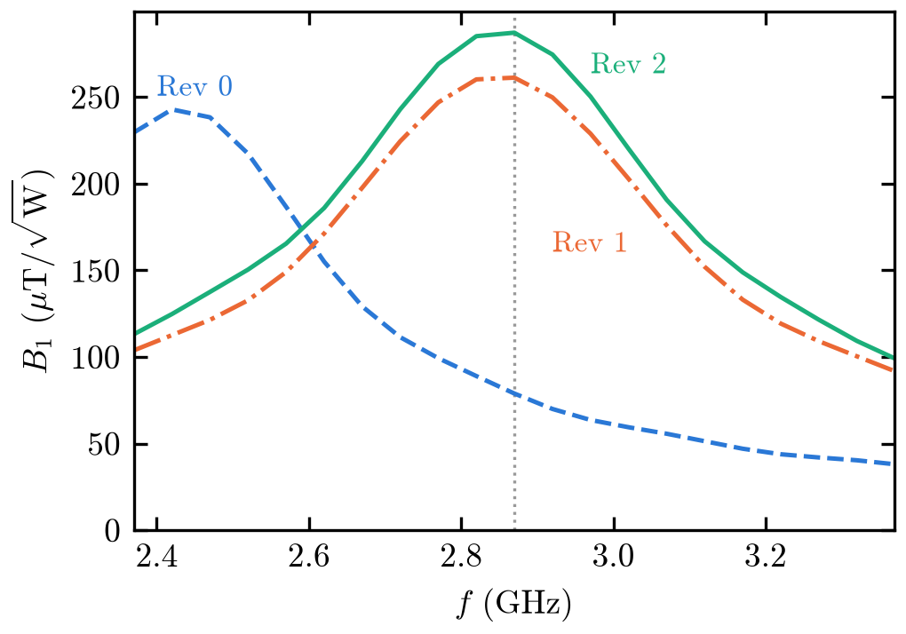

# Loop-gap antenna for NV ODMR

The design of a planar loop-gap (ring) PCB antenna for optically detected magnetic resonance
(ODMR) of NV centres in diamond: the diamond rests on the board, over a hole in a copper ring,
and the ring's resonance near 2.87 GHz drives the NV spins. An openEMS (FDTD) model of the board
gives its S11 and the microwave field B1 at the diamond, which is what the design is judged on.

The design started from Sewani et al.'s board
([Am. J. Phys. 88, 1156 (2020)](https://arxiv.org/abs/2004.02643)) and moved to Sasaki et al.'s
design on standard 1.6 mm FR4
([Rev. Sci. Instrum. 87, 053904 (2016)](https://arxiv.org/abs/1605.04627)).



## Structure

```
designs.py, settings.py   data only: the board revisions (Rev 0, 1, 2); where runs go
lib/                      shared library: geometry, solving, post-processing
sim/                      scripts: check, view or solve a design; compare the revisions
opt/                      the parameter search behind Rev 1 (archived)
docs/                     notes, e.g. how that search was run on a cluster
```

Scripts need a Python with openEMS's `CSXCAD` and `openEMS` bindings, numpy, matplotlib and h5py
(the `Dockerfile` builds one). Run them from the repo root as modules, e.g.
`python -m sim.loopgap --check`; each one's docstring lists its options.
